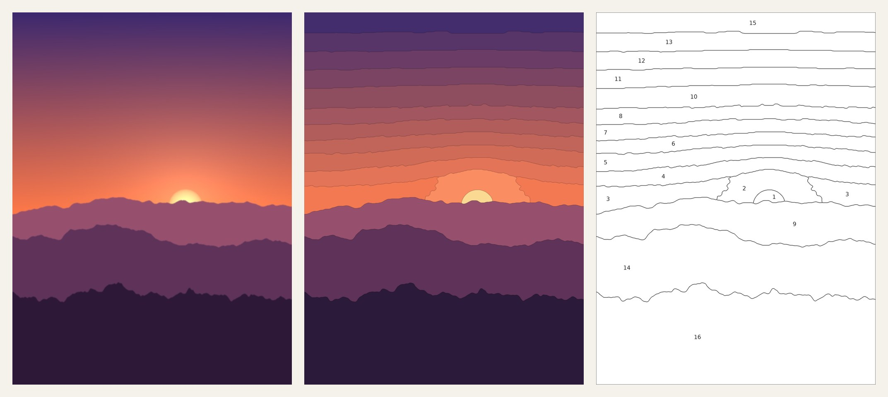
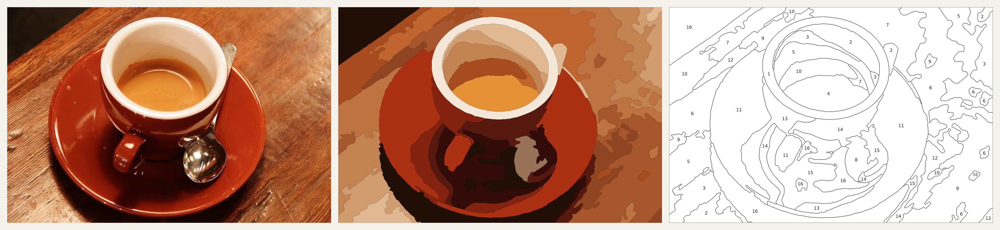
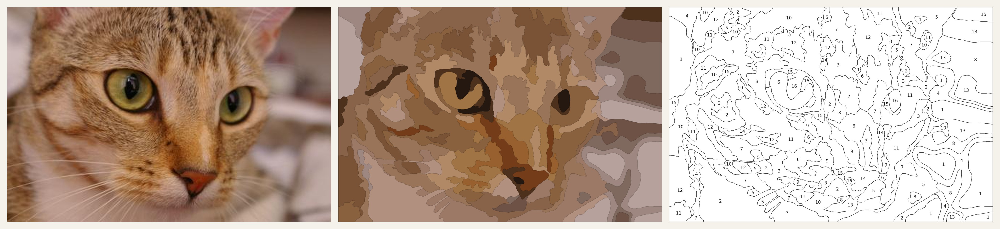

# paint-by-photo

A Claude skill that turns a photo into a printable paint-by-numbers kit and a colouring page.





Original, finished painting, numbered canvas. Each photo also gets a colour key and an outlines-only colouring page; see [`examples/mountains_kit.pdf`](examples/mountains_kit.pdf) for the A4 printout.

## Use it with Claude

**claude.ai / Claude app:** download [`paint-by-photo-skill.zip`](paint-by-photo-skill.zip) and upload it in your skills settings. Then send Claude a photo and ask for a paint-by-numbers kit.

**Claude Code:**

```bash
git clone https://github.com/thibaud360/paint-by-photo
cp -r paint-by-photo/skills/paint-by-photo ~/.claude/skills/
```

## Just want a prompt?

Send this to Claude along with your photo, no install needed:

```
Make a paint-by-numbers kit from this photo with Python (pillow, numpy, opencv, scipy, scikit-learn). Smooth it with a bilateral filter, k-means in LAB to 16 colours, blur-and-argmax each colour mask as a mode filter, then merge every region smaller than ~30 mm² or thinner than ~2.7 mm radius into its most similar neighbour. Upscale the label map smoothly, draw thin dark-grey outlines on white, and put each region's number at its pole of inaccessibility (distance transform maximum), font sized to fit. Give me: numbered canvas PNG, colour key PNG with hex codes, filled preview PNG, outlines-only colouring page, and an A4 PDF with canvas, palette and colouring page.
```

## Use it without Claude

```bash
pip install pillow numpy opencv-python scipy scikit-learn
python skills/paint-by-photo/scripts/paint_by_photo.py photo.jpg
python skills/paint-by-photo/scripts/paint_by_photo.py photo.jpg --colors 24 --detail high
python skills/paint-by-photo/scripts/paint_by_photo.py photo.jpg --size letter --mix -o my_kit
```

Writes `photo_numbers.png`, `photo_palette.png`, `photo_preview.png`, `photo_coloring.png` and `photo_kit.pdf` to `paint_out/`.

Flags: `--colors N` (2 to 60, default 16), `--detail low|medium|high` (how small a region may be; default medium), `--size A4|A3|letter`, `--no-pdf`, `--mix` (rough paint-mixing hint under each swatch), `--strip` (also write an original / preview / numbers strip), `--seed`, `-o DIR`.

## License

MIT
